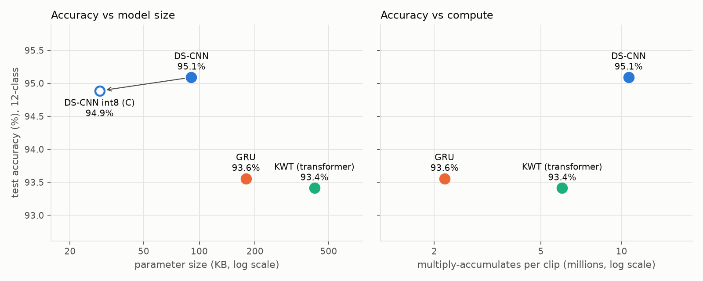
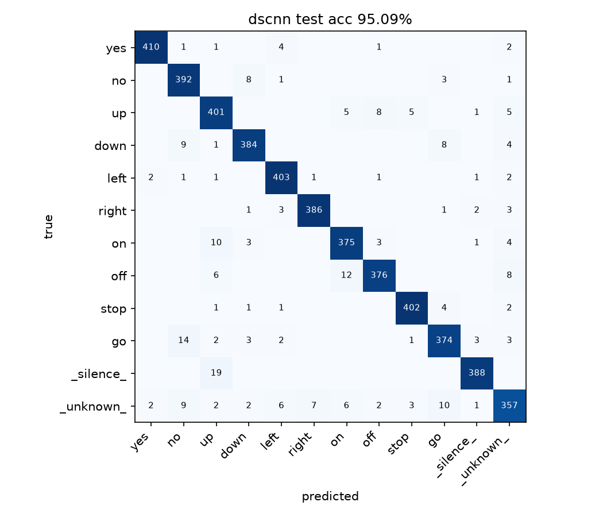
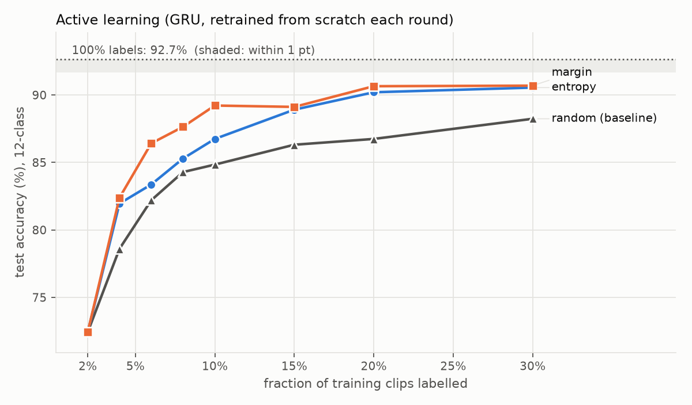
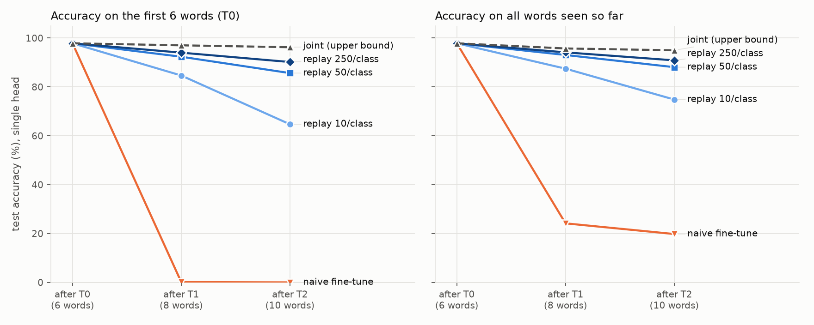
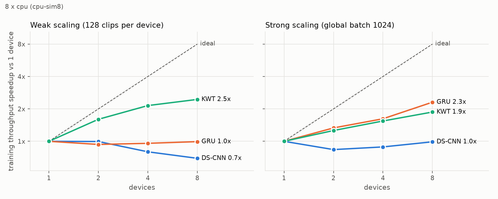

# Earshot Lite

A wake-word engine, from training in JAX to running in C. Detects spoken keywords ("yes", "stop", "go", ...) on Google's [Speech Commands v0.02](https://arxiv.org/abs/1804.03209) dataset.

| Milestone | Status |
|---|---|
| M1: data pipeline + DS-CNN baseline (JAX/Flax) | done |
| M2: INT8 quantization + dependency-free C inference engine | done |
| M3: CNN vs GRU vs tiny transformer (accuracy / size / speed) | done |
| M4: data-parallel training (8 simulated devices → Kaggle TPU) | code + CPU validation done; TPU run pending |
| M5: continual learning with a replay buffer | done |
| M6: active learning | done |

## Results so far

| Model | Precision / runtime | Test acc | Params | Size | MACs / clip | Latency, batch 1 | Throughput, batch 512 |
|---|---|---|---|---|---|---|---|
| **DS-CNN** | float32, JAX (CPU) | **95.09%** | 23,180 | 90.5 KB | 10.6M | 2.95 ms | 383 µs/clip |
| **DS-CNN int8** | int8, plain C (1 core) | **94.89%** | 23,180 | **28.9 KB** | 10.6M | **0.88 ms** | – |
| GRU | float32, JAX (CPU) | 93.56% | 45,708 | 178.5 KB | 2.2M | 0.72 ms | 63 µs/clip |
| KWT (transformer) | float32, JAX (CPU) | 93.41% | 107,212 | 418.8 KB | 6.0M | 2.33 ms | 84 µs/clip |



## Model comparison (M3)

All three models use the same 30-epoch recipe: the same data, augmentation, batch size and warmup-cosine schedule, and best-on-validation checkpointing. Only the learning rate, weight decay and gradient clipping differ, set per architecture in [`models/__init__.py`](earshot/models/__init__.py). There was no hyperparameter sweep, and each model was trained with one seed.

- **DS-CNN** ([`dscnn.py`](earshot/models/dscnn.py)): a depthwise-separable CNN, described below.
- **GRU** ([`gru.py`](earshot/models/gru.py)): 2 stacked unidirectional GRU layers (hidden size 64) over the 49 frames, classifying from the final hidden state. Unidirectional means it could run streaming, one frame at a time.
- **KWT** ([`kwt.py`](earshot/models/kwt.py)): a tiny [Keyword Transformer](https://arxiv.org/abs/2104.00769). Each frame is a token, with a CLS token, learned positional embeddings and 3 pre-LayerNorm blocks (dim 64, 4 heads, MLP width 128).

MACs are counted by walking each model's jaxpr ([`flops.py`](earshot/flops.py)), and they match hand counts exactly. XLA's built-in cost analysis counts a `scan` body only once, which would undercount the GRU by 49×.

**Findings:**
- **The CNN wins on accuracy and size.** DS-CNN is the most accurate model and also the smallest. After int8 quantization it is 3.1× smaller still, for −0.20 pts.
- **Compute is a different story.** The GRU needs 4.9× fewer MACs than the DS-CNN for −1.5 pts. If the target is MAC-limited rather than memory-limited, it's a reasonable trade.
- **The transformer is last on every axis at this scale:** 4.6× the DS-CNN's parameters for −1.7 pts. The KWT paper trains for 140 epochs with heavier augmentation; with an equal 30-epoch budget and only 37k clips, attention doesn't pay for itself.
- **MACs don't predict latency.** On CPU the DS-CNN has the most MACs but its throughput is 6× worse than the GRU's (383 vs 63 µs/clip), because XLA's CPU path for depthwise convolutions is slow. The C engine runs the same network in 0.88 ms on a single core. Batch-1 JAX latency is mostly per-call dispatch overhead and says little about the models themselves.
- **Noise:** the standard error on a 4,888-clip test set is about ±0.3 pts. The DS-CNN's lead over the GRU (1.5 pts) is well outside that. The GRU vs KWT gap (0.15 pts) is not.

The DS-CNN was trained for 30 epochs on CPU (about 1 min/epoch, 37k training clips). Best validation accuracy was 95.45%. The weakest class is `_unknown_` at 87.7%, and the most common confusions are on↔off, go↔no and down↔no.

Known failure mode: 19 of 407 silence clips at moderate noise levels are classified as "up". Pure digital silence is always correct. The fix is to mix background noise into the keyword clips during training, which needs augmentation on the raw audio rather than on cached features.



## Active learning (M6)

[`active.py`](earshot/active.py) runs pool-based active learning with a simulated labeler: the 12-class training set is the unlabeled pool, and a clip's label is revealed only when a strategy picks it. Every strategy starts from the same random 2% seed set. Each round retrains the GRU from scratch on the labeled set (1,500 steps), scores the remaining pool, and buys labels up to the next budget. The GRU is the learner because it trains about 5× faster per clip than the DS-CNN on CPU.

| Strategy | 2% | 4% | 6% | 8% | 10% | 15% | 20% | 30% |
|---|---|---|---|---|---|---|---|---|
| Random (baseline) | 72.4% | 78.6% | 82.2% | 84.3% | 84.8% | 86.3% | 86.7% | 88.2% |
| Entropy | 72.4% | 82.0% | 83.4% | 85.3% | 86.7% | 88.9% | 90.2% | 90.5% |
| **Margin** | 72.4% | 82.4% | **86.4%** | 87.6% | **89.2%** | 89.1% | 90.7% | 90.7% |

Same model and recipe on 100% of the labels (36,921 clips, 15 epochs): **92.66%**.



- **Uncertainty sampling roughly triples label efficiency.** Margin sampling with **10%** of the labels (89.2%) beats random sampling with **30%** (88.2%). With 6% of the labels it comes within 0.3 points of random at 20%. Entropy needs about 2× fewer labels than random.
- **Margin beats entropy** at low budgets. Margin looks only at the top-2 confusion (e.g. "on" vs "off"), while entropy also rewards clips that are diffusely uncertain across many classes.
- **The target I fixed in advance was not met.** The goal was within 1 point of full-data accuracy (≥91.66%) within 30% of the labels; the best result is 90.7%. Both uncertainty curves are flat from 20% to 30%. That fits the fixed 1,500-step training budget per round being the limit rather than the labels, since the full-data model trained for 4,320 steps. Comparisons between strategies are fair, because every strategy gets identical compute; the gap to full data mixes fewer labels with less compute. A fairer test would retrain the final labeled sets with full-data compute (`active.py` now saves each round's labeled indices for this).
- Limitations: one seed, no confidence intervals. Top-k selection makes no attempt to diversify a batch, and the labeler is simulated.

## Continual learning (M5)

The task is to teach the model new keywords later without forgetting the old ones. [`continual.py`](earshot/continual.py) uses the **class-incremental** setting: a single head covers every word seen so far, and the model isn't told which task a clip belongs to. The DS-CNN learns `yes no up down left right` (T0), then `on off` (T1), then `stop go` (T2). Every method starts from the same T0 model, and each later stage runs 10 epochs.

| Method | Stored clips | First-6-words accuracy, after T0 → after T2 | Old words (final) | New words (final) | All 10 words |
|---|---|---|---|---|---|
| Naive fine-tune | – | 97.8% → **0.0%** | 0.0% | 98.9% | 19.8% |
| Replay, 10/class | 80 (0.3% of old data) | 97.8% → 64.7% | 69.1% | 97.7% | 74.8% |
| Replay, 50/class | 400 (1.6%) | 97.8% → 85.6% | 86.0% | 96.5% | 88.1% |
| Replay, 250/class | 2,000 (8.1%) | 97.8% → **90.2%** | 89.4% | 96.7% | **90.9%** |
| Joint (upper bound) | all | 97.8% → 96.2% | 95.4% | 93.4% | 95.0% |



- **Catastrophic forgetting is total.** Naive fine-tuning on just "on"/"off" takes the first six words from 97.8% to 0.1%, and after T2 it never predicts an old word at all.
- **Replay buys back most of it cheaply.** Storing 50 clips per old word (1.6% of the old training data, 1.5 MB of float16 features) keeps 86% old-word accuracy, and 250 per word keeps 89%. The joint-training upper bound is 95%.
- **Replay leans toward new words.** Replay scores higher than joint on new words (96.7% vs 93.4%) but lower on old ones. Half of every replay batch is new data while only a small buffer stands in for the old classes, so the classifier favors the newest classes. This recency bias is the well-known class-incremental failure mode that methods like iCaRL/BiC correct.

Setup details:
- Each replay step trains on half new data and half buffer samples (experience replay), with a random, class-balanced buffer.
- Input normalization uses T0 statistics only, so no future data leaks in.
- The 10-way head is allocated up front, and classes not yet seen are masked out of the softmax. That's equivalent to growing the head, and [`test_continual.py`](tests/test_continual.py) checks that masked classes get exactly zero gradient.
- Keywords only (no silence/unknown), one seed.

## Data-parallel training (M4)

[`parallel.py`](earshot/parallel.py) adds SPMD data parallelism with `jax.sharding`, in about 40 lines. It builds a 1-D device mesh with a `data` axis, replicates the model and optimizer state, and shards each batch along `data`. The jitted train step is **unchanged**: XLA partitions it and inserts the gradient all-reduce. BatchNorm statistics are reduced over the global batch, so this is synchronized BatchNorm with no extra code.

```bash
python -m earshot.train --devices 8 --sim-cpu-devices 8   # laptop: 8 simulated CPU devices
python -m earshot.train --devices 8                       # TPU: same code, real devices
```

**Correctness.** [`test_parallel.py`](tests/test_parallel.py) runs 3 training steps sharded over 8 devices and on 1 device, then checks that the losses, all parameters and the BatchNorm running statistics agree, for all three models. Dropout and augmentation draw identical random numbers either way (`jax_threefry_partitionable`). One finding from writing the test: with Adam the two runs *don't* agree parameter-for-parameter after step 1. Some gradients are mathematically zero, for example attention key biases, because softmax ignores a constant shift. Those gradients are pure floating-point noise from the different reduction order, and Adam's first update is roughly `lr · sign(g)`, which turns that noise into full-size steps. The equivalence test uses SGD, where the update is linear in the gradient.

**Scaling.** [`scaling.py`](earshot/scaling.py) times the real train step on device-resident synthetic batches at 1/2/4/8 devices, for weak scaling (128 clips per device) and strong scaling (global batch 1,024).

**TPU numbers: not run yet.** The [Kaggle notebook](kaggle/earshot_tpu.ipynb) writes `results/m4_scaling_tpu.json` and `docs/m4_scaling_tpu.png`, which go here.

On 8 *simulated* CPU devices, all "devices" share the same 32 hardware threads, so this run checks the plumbing rather than measuring speedup. The GRU and KWT still gain up to 2.5×, because XLA runs the 8 device programs concurrently and uses cores that a single small-op CPU device leaves idle. The DS-CNN's depthwise convolutions don't benefit.



**End-to-end check on simulated devices:** a full 30-epoch DS-CNN run on 8 simulated devices used global batch 1,024 (128 per device), lr 6e-3 and a 2-epoch warmup. It reached **93.76% test** (best validation 94.96%), against 95.09% for the single-device batch-128 recipe. It ran the same number of epochs but 8× fewer optimizer steps (1,080 vs 8,640). Its augmented training accuracy was also lower (89.0% vs 91.0%), so the model is under-trained, not overfitting. The TPU notebook therefore runs 60 epochs at batch 1,024.

**Running it on a TPU:** open [`kaggle/earshot_tpu.ipynb`](kaggle/earshot_tpu.ipynb) on Kaggle with the TPU accelerator and internet enabled. It pins the versions, builds the data cache, runs the scaling benchmark and a full 8-core training run, and zips the results.

## INT8 C engine

[`csrc/`](csrc/) is a C11 inference engine: no libraries beyond libm, no malloc, two static 32,000-byte activation buffers plus a 2 KB input buffer (64.5 KB RAM), and 28.9 KB of constant parameters. The runtime ([`earshot.c`](csrc/earshot.c), ~150 lines) is model-agnostic for conv / depthwise conv / avgpool / fc. The model itself is a generated [`earshot_model.c`](csrc/earshot_model.c) holding the weights, quantization parameters and a layer table.

```c
#include "earshot.h"
int8_t logits[12];
int cls = earshot_predict(logmel /* float[49][40] raw log-mel */, logits);
puts(earshot_model.class_names[cls]);
```

**Quantization scheme** (TFLite-style post-training quantization, calibrated on 2,000 training clips):
- weights: int8, symmetric, one scale per output channel
- activations: int8, asymmetric, one scale and zero-point per tensor
- biases: int32
- BatchNorm folded into the conv weights; ReLU fused into the output clamp
- requantization: an int32 multiplier and a right shift in int64, rounded half up. There is no floating point after the input quantizer.

**Verification chain** (`python -m earshot.quant runs/dscnn-m1`, full 4,888-clip test set):

| Check | Result |
|---|---|
| Folded float numpy graph vs JAX (BN folding, SAME padding) | max \|Δlogit\| 2.3e-5 |
| int8 numpy reference vs float: accuracy | 94.89% vs 95.09% (−0.20 pts) |
| int8 vs float top-1 agreement | 99.14% |
| **C engine vs int8 reference** | **bit-exact on 4,888 / 4,888 clips** |

The numpy int8 reference ([`quantize.py`](earshot/quant/quantize.py)) is the spec, and the C code must reproduce its logits exactly. `pytest` checks this on a random-weight model (including saturating inputs) and on 600 real test clips from the trained model.

**Speed:** 0.88 ms per clip (about 10.7M multiply-adds) on one laptop CPU core, compiled with `zig cc -O2` (clang). That's best of 5 trials; on this hybrid CPU a trial that lands on an efficiency core takes about 1.6 ms. The first version took 3.5 ms. It accumulated each output channel's dot product separately, which forced a horizontal sum per output. Switching the conv weights to `[kh][kw][cin][cout]` and vectorizing across output channels made it 4× faster, with identical outputs. JAX's 3.0 ms batch-1 figure is mostly per-call dispatch overhead, so it isn't a like-for-like comparison.

Build by hand with any C11 compiler:

```bash
cc -std=c11 -O2 -Icsrc csrc/earshot.c csrc/earshot_model.c csrc/test_runner.c -o runner -lm
```

The Python tooling finds a compiler automatically: `$CC`, then gcc/clang on PATH, then the pip-installable `ziglang`.

## Task

Standard 12-class keyword spotting: `yes no up down left right on off stop go` + `_silence_` + `_unknown_` (the other 25 words). Splits follow the dataset's `validation_list.txt` / `testing_list.txt`. Silence and unknown are subsampled to the mean keyword-class size, which gives a 4,888-clip test set (the official v0.02 test set has 4,890).

## Front-end

40 log-mel bins × 49 frames (40 ms Hann window, 20 ms hop, 1024-pt FFT, 20–7600 Hz, `log(mel + 1e-6)`), written in plain numpy in [`earshot/data/features.py`](earshot/data/features.py) so it can be ported line-for-line to C. Features are cached once as float16 (~430 MB). The cache builder streams WAVs straight out of the `.tar.gz` without extracting them.

Silence clips are random 1 s crops of the dataset's background-noise recordings at random gain. Train, val and test crops come from disjoint time ranges of each recording, so no noise segment is shared between splits.

## Model: DS-CNN

Depthwise-separable CNN from [Hello Edge](https://arxiv.org/abs/1711.07128) (DS-CNN-S): a 10×4 stride-2 conv, then 4 × (depthwise 3×3 → pointwise 1×1), each followed by BatchNorm + ReLU, then global average pooling → linear. It has 23,180 parameters. Convolutions have no bias because BatchNorm follows each one, and BatchNorm gets folded into the weights before int8 quantization.

Training: AdamW (lr 3e-3, wd 1e-4), 1-epoch warmup then cosine decay, batch 128, 30 epochs. Augmentation runs inside the jitted step: a random ±100 ms time shift plus one SpecAugment time mask and one frequency mask. The checkpoint with the best validation accuracy is evaluated once on test.

## Reproduce

```bash
python -m venv .venv && .venv/Scripts/activate      # or source .venv/bin/activate
pip install -r requirements.txt
python -m earshot.data.download                      # 2.4 GB
python -m earshot.data.build_cache                   # ~2 min -> data/cache/
python -m earshot.train --model dscnn --epochs 30 --out runs/dscnn-m1
python -m earshot.quant runs/dscnn-m1                # int8 + C export + parity check
python -m earshot.train --model gru --epochs 30 --out runs/gru-m3
python -m earshot.train --model kwt --epochs 30 --out runs/kwt-m3
python -m earshot.benchmark runs/dscnn-m1 runs/gru-m3 runs/kwt-m3   # table + chart
python -m earshot.continual --methods naive replay:10 replay:50 replay:250 joint --report
python -m earshot.active --full --strategies random entropy margin --report
pytest
```

Each run directory holds `model.npz` (flat, slash-keyed weights), `norm.npz` (per-bin normalization), `config.json`, `metrics.json` (test accuracy, per-class accuracy, confusion matrix, latency, history), `curves.png` and `confusion.png`.

## Layout

```
earshot/
  data/download.py      fetch the tarball
  data/features.py      log-mel front-end (numpy, C-portable)
  data/build_cache.py   tarball -> cached features
  data/dataset.py       12-class task building, normalization, batching
  models/dscnn.py       DS-CNN (Flax NNX)
  models/gru.py         stacked GRU
  models/kwt.py         tiny Keyword Transformer
  train.py              training / eval / latency
  flops.py              MAC counter (walks the jaxpr, multiplies out scans)
  benchmark.py          accuracy / size / MACs / latency comparison + chart
  parallel.py           mesh / replicate / shard helpers (data parallelism)
  scaling.py            1/2/4/8-device throughput benchmark
  continual.py          class-incremental learning: naive / replay / joint
  active.py             pool-based active learning: random / entropy / margin
kaggle/earshot_tpu.ipynb  M4 on a Kaggle TPU
  checkpoint.py         flat .npz checkpoints
  plots.py
  quant/graph.py        BN folding, float numpy graph
  quant/quantize.py     calibration, int8 quantization, int8 reference (the spec)
  quant/export_c.py     QModel -> csrc/earshot_model.c
  quant/cbuild.py       compile + drive the C engine from Python
  quant/__main__.py     quantize -> export -> verify on the test set
csrc/
  earshot.h / .c        C11 runtime
  earshot_model.c       generated model
  test_runner.c         batch runner for parity tests and benchmarks
tests/                  front-end, model, dataset, quantization and C parity tests
```
